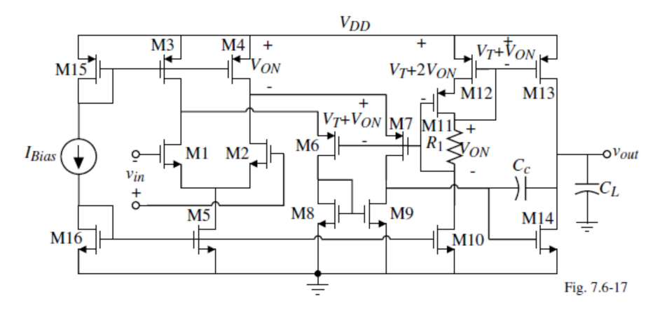
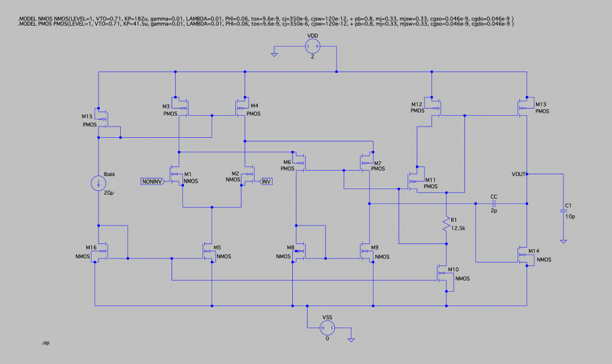
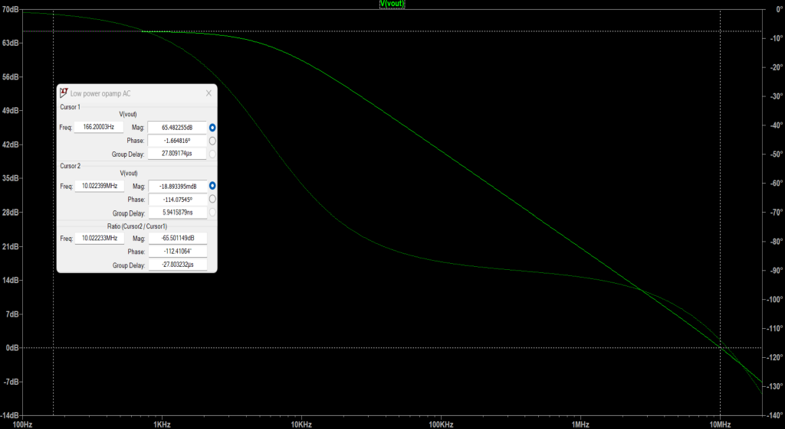
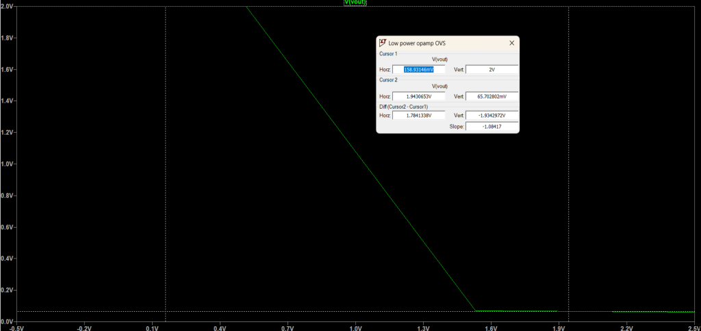
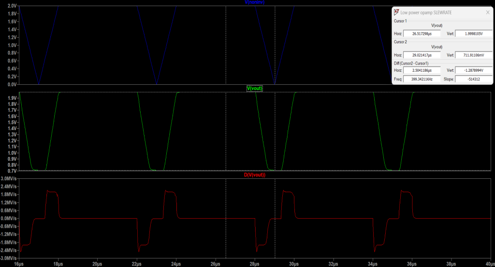
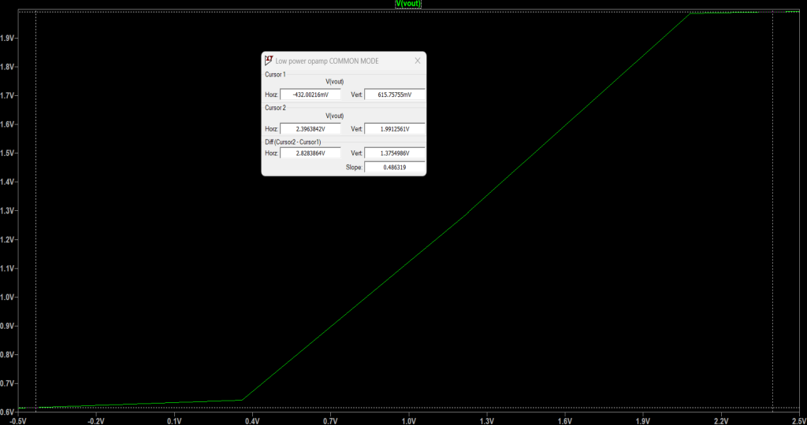

<h1 align="center">CMOS Low-Voltage Op-Amp</h1>

  <b>A folded-cascode CMOS op-amp that works from a single 2 V supply, sized by hand and verified in LTspice.</b> 
  University of Bologna · Sensor Systems Lab (Analog Circuits and Sensor Systems)

  
  
  
  
  

  

## What this is

As supply voltages drop, a classic op-amp runs out of headroom: once VDD gets close to two transistor thresholds (2VT), there is no room left for the input common-mode range and the output swing. This project designs an op-amp that still meets its targets at **VDD = 2 V**.

The topology (after Allen & Holberg, *CMOS Analog Circuit Design*, Fig. 7.6-17) has four parts:

1. **Input stage**: NMOS differential pair M1, M2 with current-source loads M3, M4.
2. **Folded cascode** M6, M7 that redirects the differential output currents.
3. **NMOS current mirror** M8, M9 that converts the signal to single-ended.
4. **Miller-compensated class-A output stage** M13, M14 for second-stage gain.

Compared with a classic two-stage design it gives the input pair balanced loads while keeping similar performance at a lower supply.

## Target specification

| Parameter | Target |
|---|---|
| Supply VDD | 2 V |
| Slew rate | ±10 V/µs |
| Load capacitance CL | 10 pF |
| Input common-mode range | 1 V to 2.5 V |
| Output swing | 0.5 V to 1.75 V |
| Gain-bandwidth | 10 MHz |
| Phase margin | 60° |

Process: VTn / VTp = 0.71 V / −0.7 V, β′n / β′p = 110 / 50 µA/V², λn / λp = 0.04 / 0.05.

## How it was designed

All transistors use L = 1 µm; the design finds each W/L ratio in eight steps.

| Step | What is computed | Result |
|---|---|---|
| 1 | Miller capacitor from CL, tail current from the slew rate, gm from the GBW | Cc = 2 pF, I5 = 20 µA, gm1 = 125.7 µS |
| 2 | Input pair M1, M2 | W/L = 7.18 |
| 3 | Loads M3, M4 from the maximum input common-mode voltage | W/L = 19.2 |
| 4 | Level-shift resistor and M11, M12 | R1 = 12.5 kΩ, W/L = 12.8 |
| 5 | Folded cascode M6, M7 (same VGS and current as M11, M12) | W/L = 12.8 |
| 6 | Mirror M8, M9, kept small to push the parasitic pole out | W/L = 1 |
| 7 | Output transistor M14 from the 60° phase-margin rule (gm14 = 10·gm1) | W/L = 22.85 |
| 8 | Output current source M13 from the current ratio | W/L = 201 |

Final widths in µm (L = 1 µm everywhere):

| M1 | M2 | M3 | M4 | M5 | M6 | M7 | M8 | M9 | M10 | M11 | M12 | M13 | M14 | M15 | M16 |
|---|---|---|---|---|---|---|---|---|---|---|---|---|---|---|---|
| 7.18 | 7.18 | 19.2 | 19.2 | 44.0 | 12.8 | 12.8 | 1.00 | 1.00 | 44.0 | 12.8 | 12.8 | 201 | 22.8 | 19.2 | 44.0 |

## Simulation in LTspice

  

The circuit was checked with an operating-point analysis (every transistor in the intended region), then AC, DC and transient runs:

| AC analysis (Bode plot) | Output swing (DC sweep) |
|---|---|
|  |  |
| **Slew rate (transient)** | **Input common-mode range (DC sweep)** |
|  |  |

## Results

| Parameter | Target | Simulated |
|---|---|---|
| Output swing, max | 1.75 V | 2 V |
| Output swing, min | 0.5 V | 0.065 V |
| Input common-mode, max | 2.5 V | 2.5 V |
| Input common-mode, min | 1 V | 1 V |
| Phase margin | 60° | **66°** |
| Gain-bandwidth | 10 MHz | 10 MHz |
| Slew rate | 10 V/µs | I5 / Cc = 20 µA / 2 pF = 10 V/µs |

The output swing comes out wider than required on both sides, and the phase margin has 6° to spare.

## What's in this repo

| File | What it is |
|---|---|
| [`Low-Voltage-OpAmp-Report.pdf`](Low-Voltage-OpAmp-Report.pdf) | The full (corrected) report: specification, design steps with equations, operating-point table, all simulation plots and the comparison table |
| [`docs/`](docs) | The figures used on this page, taken from the report |

## Skills shown

Low-voltage analog design · folded cascode · Miller compensation and phase margin · CMOS sizing by hand · LTspice (operating point, AC, DC and transient analysis)

## Related

[CMOS Two-Stage Op-Amp](https://github.com/theommishra-dev/cmos-two-stage-opamp): the first project in the course, a classic two-stage op-amp on ±2.5 V.

---

Om Mishra · MSc Electronic Engineering, University of Bologna. This repository holds the project report.
